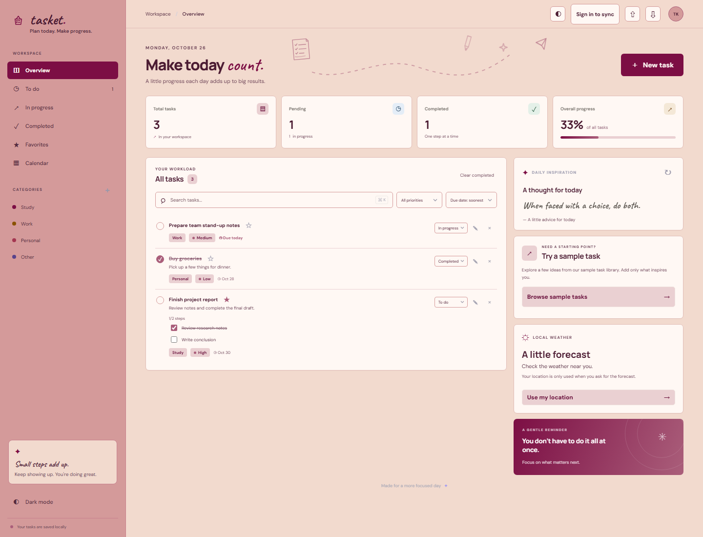
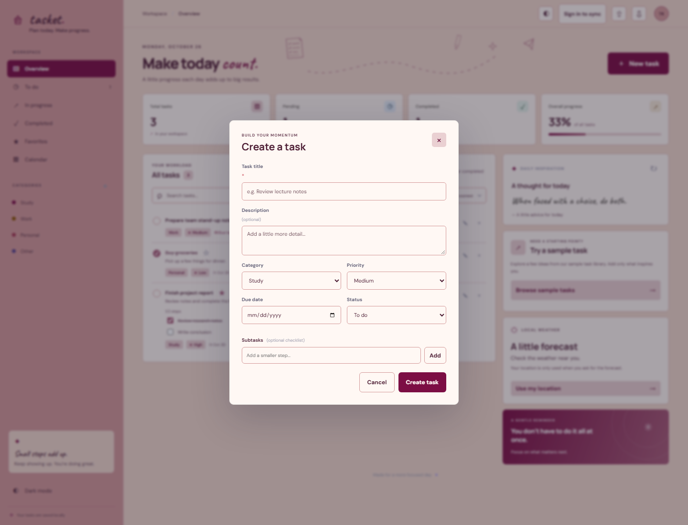
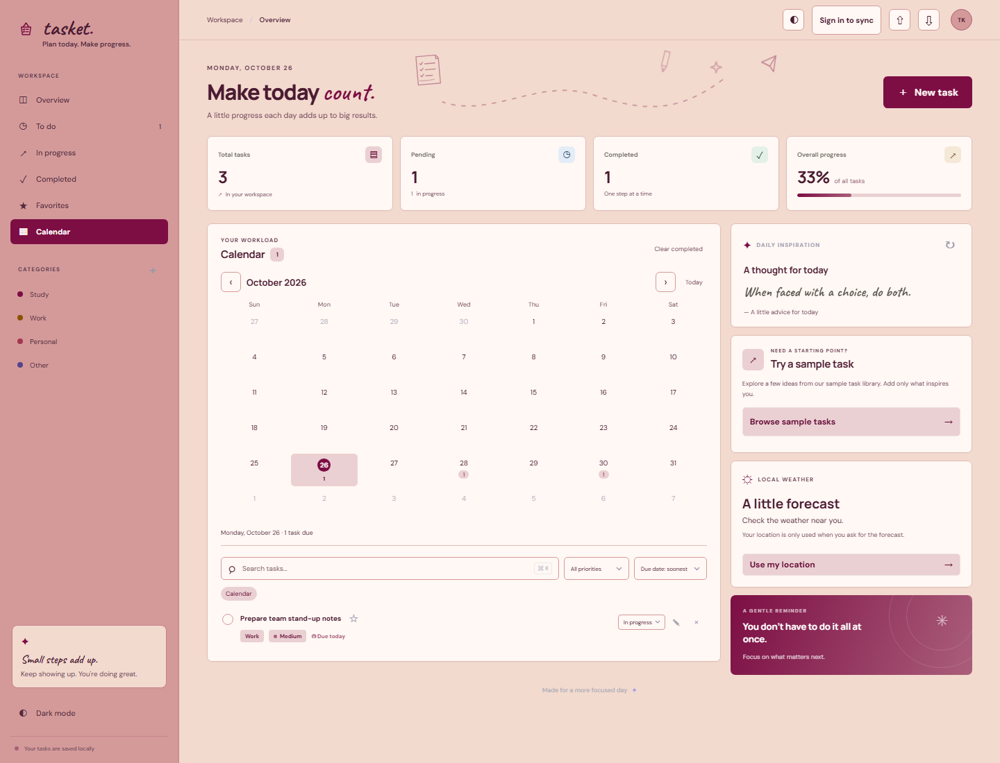

# Tasket

**A calm, responsive task dashboard to plan your day and make progress.**

Tasket helps students and individuals organize school, work, and personal tasks in one place. Its objective is to make everyday planning easier with clear priorities, due dates, progress tracking, and a focused mobile-friendly interface. Tasks work locally in the browser; optional Supabase accounts can sync them across devices.

**Live app:** [alfia-ashraf.github.io/TaskFlow](https://alfia-ashraf.github.io/TaskFlow/)

## Screenshots

The screenshots below show the dashboard, creating a task, and the calendar. The tasks shown are sample data used for these screenshots.

### Main dashboard



### Task management



### Calendar



## Features

- Create, edit, delete, complete, and favorite tasks.
- Add a category, priority, description, due date, and checklist subtasks to a task.
- Search tasks, filter by status/category/priority, and sort by due date, priority, or date added.
- View task totals, completion progress, and tasks on a monthly calendar.
- Keep tasks and theme preferences in browser `localStorage`.
- Optionally sign in with Supabase to sync tasks across devices.
- Switch between light and dark themes.
- Import and export tasks as JSON, and clear completed tasks.
- Browse optional sample tasks, daily inspiration, and local weather.
- Use a responsive mobile layout with bottom navigation and a quick-add button.

## Technologies

| Technology | Purpose |
|---|---|
| HTML | Page structure and accessible forms |
| CSS | Responsive layout, themes, and visual styling |
| JavaScript (vanilla) | Task management, rendering, browser storage, and API requests |
| `localStorage` | Saves tasks and theme preference in the current browser |
| Supabase Auth and Postgres | Optional account sign-in and cross-device task sync |

## APIs and integrations

| Service | Used for | Notes |
|---|---|---|
| [DummyJSON Todos API](https://dummyjson.com/docs/todos) | Optional sample tasks | Samples are separate from your saved tasks; you choose which to add. |
| [Advice Slip API](https://api.adviceslip.com/) | Daily inspiration | The dashboard reports an error if the service is unavailable. |
| [Open-Meteo](https://open-meteo.com/) | Optional local weather | Uses your location only after you select **Use my location**; no API key is required. |
| [Supabase](https://supabase.com/docs) | Optional authentication and cloud task sync | Tasks are protected by Postgres row-level security. |

Tasket does not send your locally stored tasks to DummyJSON or Advice Slip. Weather coordinates are sent to Open-Meteo only when you request the weather. The Supabase publishable key is intended for browser use; never add a Supabase secret or `service_role` key to this project.

## Run locally

You can use Tasket without an account. A local web server is recommended for API requests and authentication.

### Option 1: VS Code Live Server

1. Download or clone this repository and open the `TaskFlow` folder in VS Code.
2. Install the **Live Server** extension if you do not already have it.
3. Open `index.html`, right-click in the editor, and select **Open with Live Server**.
4. Use the address Live Server opens, usually `http://127.0.0.1:5500/`.

### Option 2: Python web server

If Python is installed, open a terminal in the project folder and run:

```powershell
py -m http.server 8000
```

Then visit [http://localhost:8000](http://localhost:8000).

## Optional: Configure Supabase cloud sync

Without Supabase setup, tasks remain saved in the current browser and are not shared between devices.

1. Create a Supabase project.
2. In **SQL Editor**, run the SQL in [`supabase-schema.sql`](./supabase-schema.sql). It creates the task table and row-level security policies.
3. Copy your Supabase **Project URL** and **Publishable key** from the project API settings.
4. Add those values to [`supabase-config.js`](./supabase-config.js):

   ```js
   window.TASKFLOW_SUPABASE_CONFIG = {
     url: "https://your-project-id.supabase.co",
     publishableKey: "sb_publishable_your_key"
   };
   ```

5. In Supabase **Authentication → URL Configuration**:
   - Set **Site URL** to `https://alfia-ashraf.github.io/TaskFlow/`.
   - Add `https://alfia-ashraf.github.io/TaskFlow/` to **Redirect URLs**.
   - If testing locally, add your local server URL too, such as `http://127.0.0.1:5500/`.
6. Enable the **Email** provider. Open Tasket and select **Sign in to sync** to create an account or sign in.
7. To send confirmation emails to people outside your Supabase project team, configure a custom SMTP provider under **Authentication → SMTP Settings**. Supabase's built-in sender is for testing, is limited to two emails per hour, and only sends to project team addresses. See the [Supabase SMTP guide](https://supabase.com/docs/guides/auth/auth-smtp).

Keep SMTP credentials in Supabase, not in this repository. If an email confirmation link expires, use **Resend confirmation email** in Tasket and open the newest email.

## Project files

| File | Description |
|---|---|
| [`index.html`](./index.html) | App structure and dialogs |
| [`styles.css`](./styles.css) | Dashboard, mobile layout, and theme styles |
| [`app.js`](./app.js) | Task logic, browser storage, APIs, and Supabase integration |
| [`supabase-config.js`](./supabase-config.js) | Supabase project URL and publishable key |
| [`supabase-schema.sql`](./supabase-schema.sql) | Database table and row-level security setup |
| [`favicon.svg`](./favicon.svg) | Tasket browser-tab icon |
| [`screenshots/`](./screenshots/) | README screenshots |

## Deployment

The app is static and is published with GitHub Pages from the `main` branch. Changes pushed to `main` are deployed automatically. The live site is [https://alfia-ashraf.github.io/TaskFlow/](https://alfia-ashraf.github.io/TaskFlow/).
